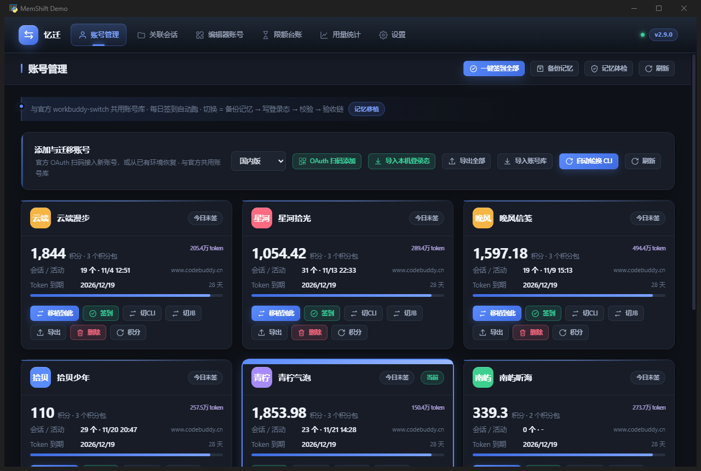
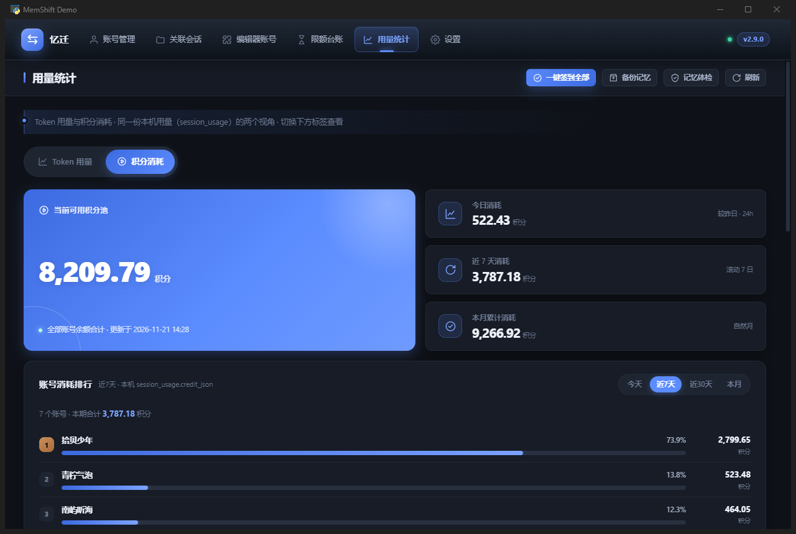
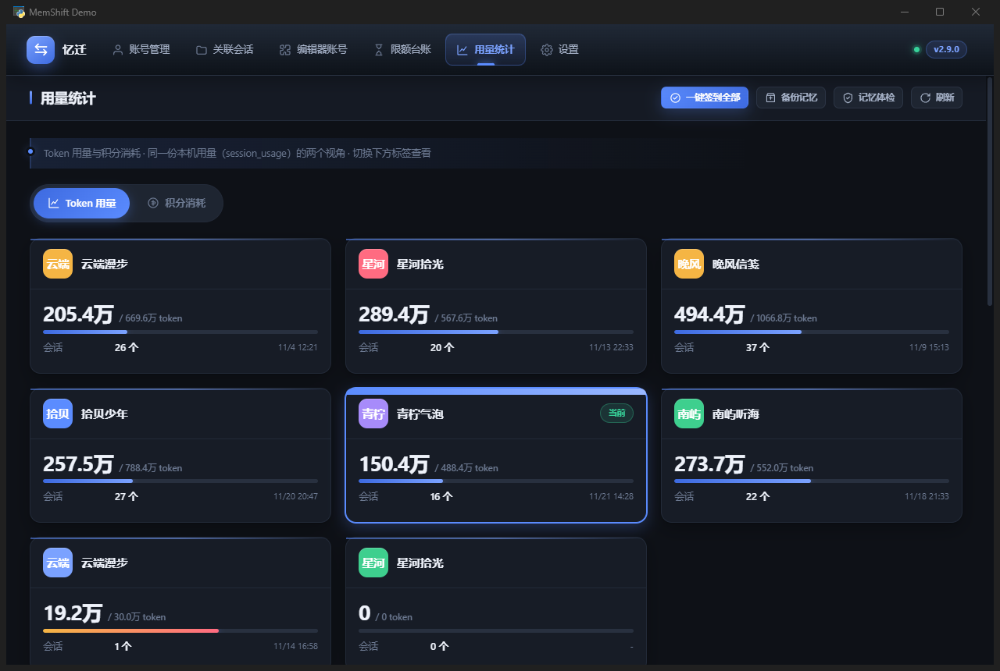

# 忆迁 MemShift · 记忆移植工作台

> 让记忆随账号一起走 —— 面向 WorkBuddy / CodeBuddy 的多账号管理工具，在开源项目 [workbuddy-switch](https://github.com/changexbc/workbuddy-switch) 基础上深度改造，专注解决一件事：**切换账号时，把会话记忆完整移植到新账号**。

**⚠️ 非官方工具**：本项目与腾讯 WorkBuddy / CodeBuddy 官方及 workbuddy-switch 原作者均无隶属关系，仅供个人效率与研究用途。

## 界面预览

*（截图为演示数据）*

| 账号管理 | 用量统计 · 积分视角 |
|---|---|
|  |  |
|  | 桌面伙伴宠物栏、限额台账等更多界面请下载体验 |

---

## 它解决什么问题

多账号使用 WorkBuddy 时有两个痛点：

1. **切换账号 = 丢失上下文**：官方客户端一个登录态，切号后聊到一半的方案、任务背景全没了；
2. **签到与积分管理繁琐**：多账号签到、临期积分、CLI 轮换，手动操作容易漏。

[workbuddy-switch](https://github.com/changexbc/workbuddy-switch) 解决了第 2 个问题（多账号切换、自动签到、积分监控、会话复制）。**忆迁在其基础上把第 1 个问题做成了完整的自动化链路**——不只是切登录态，而是把"记忆"（会话备份、记忆蓝本、主脑广播、验收）作为一个整体随账号移植。

## 主要特点（相对原版的提升）

### 🧠 记忆移植链（核心差异）
切换 = **全量备份会话记忆 → 写入目标账号登录态 → 校验 → 验收链**，每一步有留档。原版只做登录态切换 + 可选的会话复制；忆迁把"记忆不丢"做成默认行为。

### 📦 换号全自动链
一键完成：记忆蓝本落位 → Basic Memory 体检 → 主脑广播换号条 → 验收 → inbox 事件。蓝本缺失自动生成，主脑缺失自动创建最小骨架。

### 🗂 记忆主脑（memory-brain）
本地记忆库（MEMORY.md 索引 / notes/ 记忆卡 / brain-broadcast.md 广播）随程序部署；换 WorkBuddy 账号后，新账号的首个会话通过 preflight 即可见换号上下文，AI 助手的工作约定与任务状态不丢。

### 🔍 Basic Memory 融合
记忆体检三态（ok / skip / broken）+ 一键安装：自动探测 uv / pip，安装 basic-memory 并注册到 `~/.workbuddy/mcp.json`，未安装时友好提示而非报错。

### 🐾 桌面伙伴（宠物栏）
移植原项目 agent-companion 的 embed 与 host 协议：WorkBuddy 10 事件 hook、hub 状态机，任务运行状态以浮窗动物栏呈现（默认关闭，设置中开启）。

### 📊 用量统计 · 双视角
Token 用量与积分消耗合并为一个页面，Tab 切换：Token 视角（每账号 token / 30 天趋势 / Top10 模型 / 请求明细）与积分视角（可用积分池总览 / 账号消耗排行 / 各模型积分明细）。数字全部来自本机数据库，不编造。

### ⏳ 限额台账
基于 hook 事件流与客户端日志：被限流时直接告诉你"哪个账号 · 哪个模型 · 官方给的恢复时刻"。

### 🖥 三端写入 + 单文件免安装
- 账号写入覆盖 CodeBuddy CLI / CodeBuddy IDE / JetBrains 插件三端；
- Windows 单文件 exe，双击即用；首次运行自动生成蓝本与主脑骨架。

### 🎨 独立 UI
顶部横向导航 + 全宽内容区 + Bento 总览排版（区别于原版的左侧竖栏布局），内联 SVG 图标，离线可用。

## 安装

### Windows（推荐）
1. 从 [Releases](../../releases) 下载 `MemShift.exe`；
2. 双击运行（首次运行 SmartScreen 可能提示，点「更多信息 → 仍要运行」——开源项目普遍未购买签名证书）；
3. 浏览器打开提示的本地地址（默认 `http://127.0.0.1:1889`）。

### 源码运行
```bash
pip install pywebview   # 唯一第三方依赖（AES-GCM 等均为标准库自实现）
python wb_switch_pro.py
```

依赖：Windows 10+；本机已安装 WorkBuddy 桌面版（账号库与会话库来自官方客户端）。

## 已知问题

当前版本的已知问题与限制见 [KNOWN_ISSUES.md](KNOWN_ISSUES.md)（依赖官方客户端结构、未签名提示、Windows 优先等，均如实记录）。

## 使用建议

1. **先添加账号**：OAuth 扫码添加，或「导入本机登录态」把已登录的号导入；
2. **开自动签到**：设置页勾选，每 10 分钟巡检，今日已签自动跳过；
3. **切换账号**：账号卡片点「移植到此」——会先备份当前会话记忆，再写登录态、校验、验收；
4. **用量统计**：随时查看 Token / 积分消耗与账号排行。

## 架构

```
wb_switch_pro.py        # 主程序：HTTP 服务 + WebUI + 账号/签到/移植链
memshift_ext/           # 扩展模块
  ├─ hub.py             # 任务状态 hub（running/wait 状态机）
  ├─ wb_adapter.py      # WorkBuddy 事件适配
  ├─ hook_install.py    # 10 事件 hook 安装器
  ├─ pet_rail.py        # 桌面伙伴浮窗（embed 宿主）
  ├─ ext_sessions.py    # 会话复制 / 分歧检测
  ├─ ide_switch.py      # CodeBuddy IDE / JetBrains 写入
  └─ ...
companion_embed/        # 桌面伙伴前端资源（来自 workbuddy-switch，见第三方声明）
_fonts/                 # fusion pixel 字体（OFL 许可）
```

## 致谢与许可

- [workbuddy-switch](https://github.com/changexbc/workbuddy-switch)（MIT License, Copyright (c) 2026 wb-switch）：本项目的基础。忆迁在其代码与设计之上做了大量改造与扩展，其版权声明依 MIT 许可保留，见 [THIRD_PARTY_NOTICES.md](THIRD_PARTY_NOTICES.md)。
- [Fusion Pixel Font](https://github.com/TakWolf/fusion-pixel-font)（SIL OFL）：像素字体。

## 许可

本项目以 **MIT License** 开源（见 [LICENSE](LICENSE)）。第三方组件的许可声明见 [THIRD_PARTY_NOTICES.md](THIRD_PARTY_NOTICES.md)。

## 免责声明

- 本项目为社区工具，**非官方**，与腾讯及 WorkBuddy / CodeBuddy 官方无关；
- 自动签到、登录态写入、会话复制等属于对官方客户端的自动化操作，**账号相关风险自负**；
- 请遵守 WorkBuddy 官方服务条款；仅供个人学习与研究，请勿用于商业牟利。
